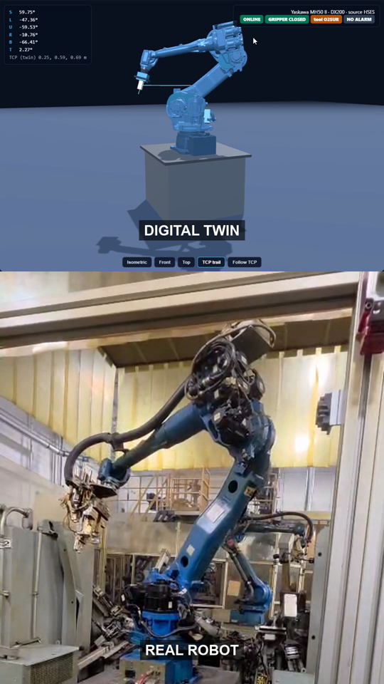
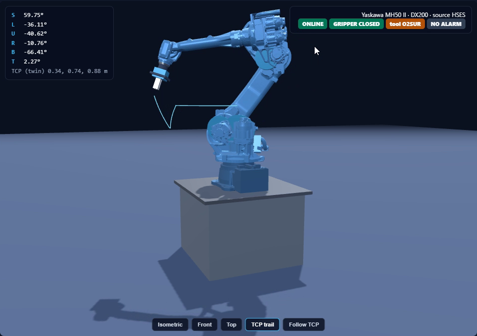
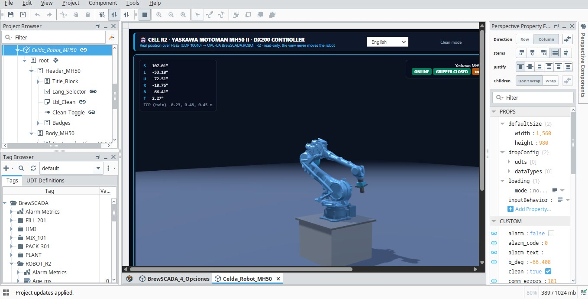

# Digital Twin of an Industrial Robot

A live 3D digital twin of a **Yaskawa Motoman MH50 II** (DX200 controller). The robot's joint positions are read over Yaskawa's HSES protocol, published through **OPC-UA**, shown in an **Ignition Perspective** HMI, and drawn as a 3D model with **Three.js** that follows the real robot.

> **This is a showcase repository.** It contains the demo video, screenshots and written explanations of the architecture and the security approach. It does not contain plant data, network addresses, credentials or recordings from the real cell.

*Click the image to open the demo video (57 s): the twin on top, the real robot below.*

## What it does

- **Reads, never writes.** Joint pulses, TCP position, servo/mode/alarm status and tool outputs are read from the controller. The twin cannot command the robot.
- **Publishes standard OPC-UA tags**, so any OPC-UA client (not only Ignition) can use them.
- **Ignition Perspective view** with live tags, a Spanish / English language selector and a "clean mode" for recording.
- **Three.js 3D twin** built from the official ROS-Industrial MH50 meshes, animated joint by joint. The page is driven by the URL hash, so the 3D scene is never reloaded when values change.
- **Self-check:** the twin computes the tool position with forward kinematics and compares it with the position reported by the controller. That difference is published as a tag (`TCP_Error_mm`).

## Screenshots

| Twin in clean mode | Ignition Designer |
| :-- | :-- |
|  |  |

## Documentation

- [Architecture](docs/ARCHITECTURE.md): data flow, components, design decisions.
- [Security](docs/SECURITY.md): how the project stays read-only and a hardening checklist for real plants.

## Status and honest limitations

- **Calibration is in progress.** Encoder pulses must be converted to degrees per axis. Only the base axis has been verified so far; the remaining axes still use placeholder scales, so the twin's pose does not always match the real robot. The `TCP_Error_mm` tag exists precisely to measure this.
- It is a prototype, not a certified safety or control system.
- Source code is kept in a private repository. If you are interested in the implementation or want to discuss the approach, open an issue.

## Stack

Python · Yaskawa HSES · OPC-UA · Ignition 8.3 (Perspective) · Three.js

## Resumen en español

Gemelo digital en vivo de un robot Yaskawa MH50 II con controlador DX200. La posición de los ejes se lee por HSES (solo lectura), se publica por OPC-UA, se muestra en una vista de Ignition Perspective y se dibuja en 3D con Three.js. Este repositorio es solo de presentación: video, capturas y explicación de la arquitectura y la seguridad, sin datos de la planta. La calibración de los ejes sigue en curso, por lo que la pose del gemelo aún no coincide siempre con la del robot real.
