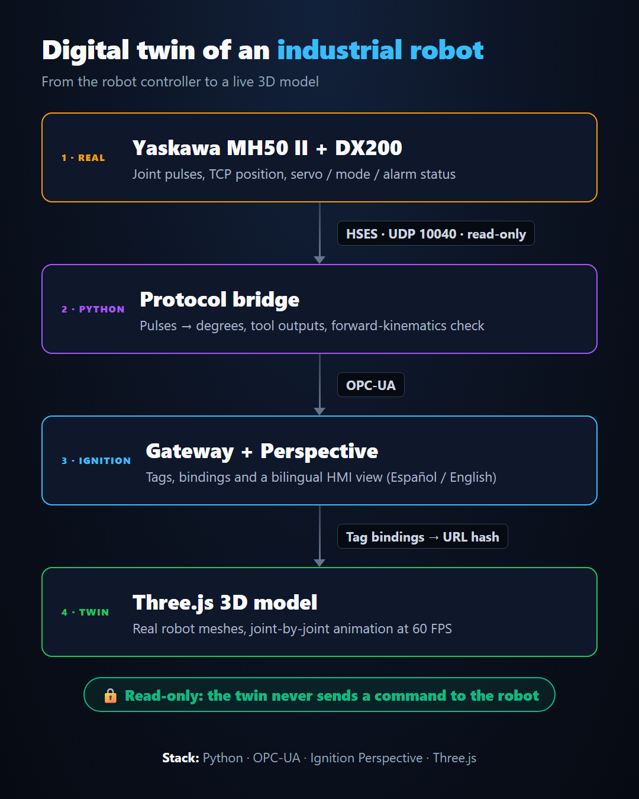
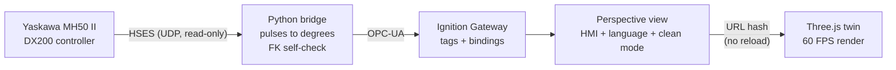

# Architecture

## 1. Reading the robot (HSES)

The DX200 has no built-in OPC-UA server. It does have **HSES (High-Speed Ethernet Server)**, Yaskawa's UDP protocol. The bridge sends only read requests:

| Request | Data |
| :-- | :-- |
| Status | servo, play / teach / remote mode, hold, alarm flags |
| Position (pulse) | raw encoder pulses per axis |
| Position (Cartesian) | TCP position and orientation, active tool number |
| Alarm | last alarm code and text |
| I/O byte | universal output group used by the tool outputs |

Polling runs at 10 Hz. A failed read increments an error counter and marks the data stale instead of stopping the service.

## 2. Pulses to degrees

HSES returns encoder pulses, not angles. Each axis has a pulses-per-degree scale, a sign, a zero offset and, if needed, a wrist coupling term. These are stored in a configuration file and calibrated per axis by moving **one axis at a time** and reading the pulses before and after.

A built-in check keeps the calibration honest: forward kinematics of the MH50 II computes the tool position from the angles and compares it to the Cartesian position reported by the controller. The difference is published as `TCP_Error_mm`. With a good calibration it should stay within a few millimetres when the robot is still.

## 3. OPC-UA

The bridge exposes every value as a node (`BrewSCADA.ROBOT_R2.*`: axis angles and pulses, TCP, status flags, alarm, tool outputs, communication health). Ignition reads them like any other OPC-UA tag, and so can any other client.

## 4. Ignition Perspective

- **Tags** are imported from a generated JSON file; **views** are generated from code so they are reproducible.
- Every view property is bound to a tag. UI-only state (language, clean mode) stays local to the view.
- The 3D page is embedded in an iframe. The view builds a URL **hash** from the tags (`#s=..&l=..&u=..`), and the page reacts to `hashchange`. Changing a value never reloads the WebGL context.

## 5. Three.js twin

- Real mesh geometry for the MH50 II (ROS-Industrial, BSD licence) placed on the URDF joint origins.
- Joint-by-joint animation with smoothing (about 0.25 s) between reads.
- Tool outputs drive the tool model: one of three tools is shown according to the controller's output bits.
- **Clean mode** hides everything except the robot for recording; **Spanish / English** labels follow the view language.

## Design decisions

| Decision | Reason |
| :-- | :-- |
| Read-only HSES client | The twin must never be able to move a production robot. |
| OPC-UA in the middle | Decouples the robot protocol from the HMI; any client can reuse the tags. |
| URL hash instead of reloading the page | Keeps the 3D scene smooth at the rate the tags change. |
| Views generated from code | Reproducible deployment and reviewable diffs. |
| Forward-kinematics self-check | A measurable number for "does the twin match the robot?". |

## Known limitations

- Per-axis calibration is still being completed (see the README).
- Pulses and Cartesian position are read in separate packets, so with the robot moving fast the self-check can show a few millimetres of extra error.
- The geometry constants are nominal values, not taken from a manufacturer drawing.
